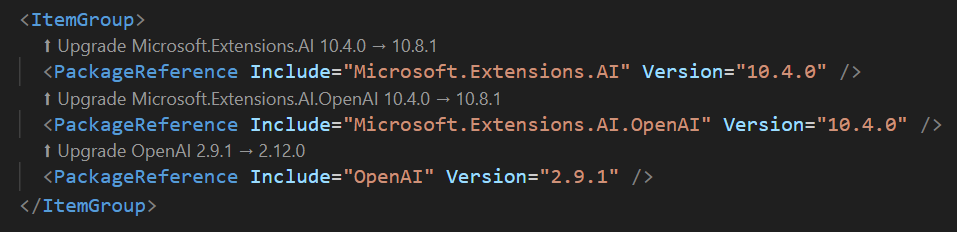
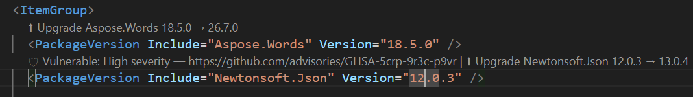
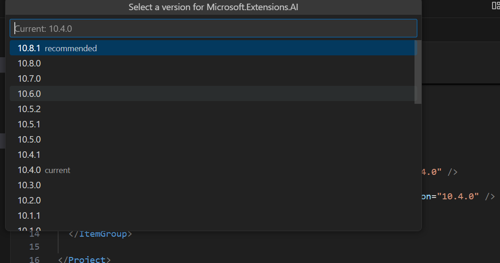
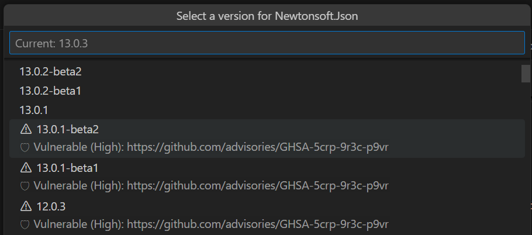
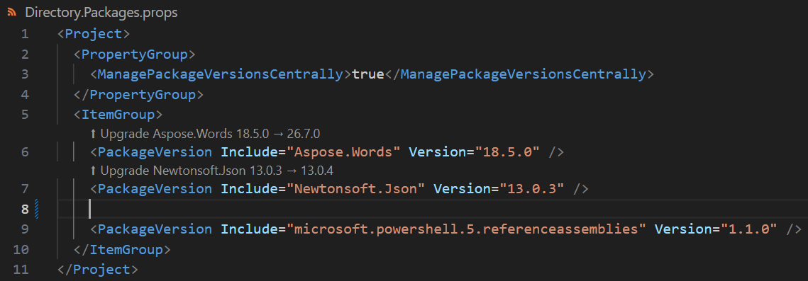
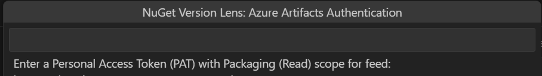

# NuGet Version Lens

Scans `Directory.Packages.props`, `.csproj`, and `packages.config` files for NuGet package references, checks each package against the feeds configured in `nuget.config`, and surfaces upgrade, deprecation, and vulnerability information directly in the editor.

## Features

- **Automatic scanning** — opening or switching to a supported project file logs its packages and their upgrade/deprecation/vulnerability status to the "NuGet Version Lens" output channel.
- **CodeLens upgrades** — an "⬆ Upgrade" CodeLens appears above any package with a newer version available. Clicking it opens a picker listing every available version (flagging deprecated/vulnerable ones), and applies the edit directly to the file.

  

- **Deprecation warnings** — packages marked deprecated on the feed show a "⚠ Deprecated" CodeLens with the reason and any suggested replacement package.
- **Vulnerability warnings** — packages with known security advisories show a "🛡 Vulnerable" CodeLens with severity and advisory links. nuget.org's public vulnerability database is checked automatically as a supplement when your configured feed(s) don't publish this data (e.g. private/internal feeds, Azure Artifacts).

  

  Selecting the CodeLens opens a version picker that flags deprecated or vulnerable versions inline:

  
  

  Applying an upgrade edits the file directly:

  

- **Azure Artifacts support** — feeds hosted on Azure Artifacts are detected automatically; you'll be prompted once for a Personal Access Token, which is stored securely in VS Code's SecretStorage (OS keychain), never on disk.

  

## Requirements

No external tooling is required. Azure Artifacts feeds need a Personal Access Token with **Packaging (Read)** scope, which the extension will prompt for on first use.

## Extension Settings

This extension contributes the following settings:

* `nugetUpgrade.cacheTTL`: How long, in seconds, to cache NuGet version/deprecation/vulnerability lookups before refetching. Default: `3600` (1 hour). Set to `0` to disable caching.
* `nugetUpgrade.includePrerelease`: Include prerelease versions when computing upgrade recommendations. Default: `false`.
* `nugetUpgrade.feedUrl`: Override the NuGet feed (service index URL) to check for upgrades, bypassing `nuget.config` resolution. Leave empty to resolve sources from `nuget.config` as usual.

## Commands

* `NuGet Lens: View Packages in Current File` — manually scan the active file and print results to the output channel.
* `NuGet Lens: Set Feed Credentials (Azure Artifacts PAT)` — update or replace the stored PAT for an Azure Artifacts feed.

## Known Issues

* `.csproj` files using Central Package Management (no `Version` attribute on `PackageReference`) are not checked directly — see the version in the corresponding `Directory.Packages.props` instead.
* Deprecation and vulnerability data availability depends on what your configured NuGet feed(s) publish; most feeds other than nuget.org don't implement NuGet's `VulnerabilityInfo` resource.

## Release Notes

### 1.0.1

Initial release: multi-format package scanning, CodeLens upgrades, deprecation/vulnerability warnings, Azure Artifacts PAT support, and configurable caching/prerelease/feed-override settings.
